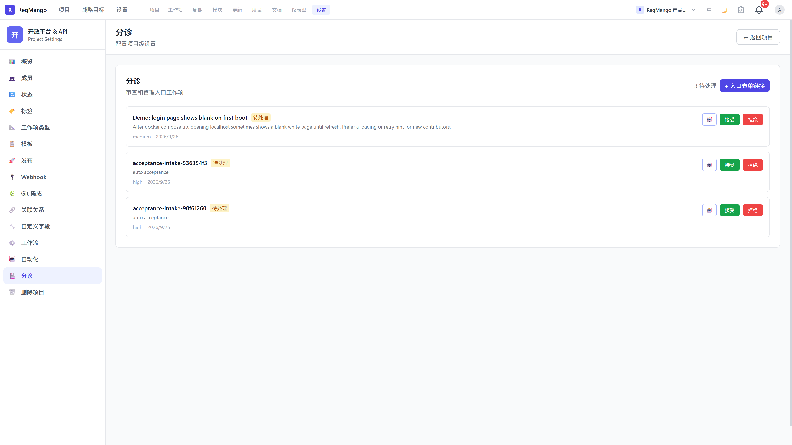

# Reqmango

**新需求先分诊，再进待办。**

自建的项目管理平台：Intake 表单收集需求，分诊队列先给出类型、优先级和疑似重复建议，人只决定拿不准的那几条。Issue / Cycle / Pages / 自动化都在同一套数据模型里，AI 当作一层能力嵌进工作流，而不是另开一个控制台。

数据在自己的机器上，不上传第三方。

[](https://github.com/vinthuy/reqmango/actions/workflows/ci.yml)
[](https://github.com/vinthuy/reqmango/releases)
[](https://github.com/vinthuy/reqmango/blob/master/LICENSE)

---

## 60 秒跑起来

已发布多架构镜像（`linux/amd64`、`linux/arm64`），这是最快的路径：

```bash
git clone https://github.com/vinthuy/reqmango.git
# 国内：git clone https://gitcode.com/yongfeng9m-/reqmanpy.git reqmango
cd reqmango
cp .env.example .env
docker compose pull
docker compose up -d
```

打开 **http://localhost** ，用演示账号登录：

| | |
|---|---|
| 邮箱 | `demo@example.com` |
| 密码 | `demo1234` |

想用 AI 分诊：在 `.env` 里填 `AI_API_KEY`，重启后端。

!!! warning "演示账号只用于本地"
    `SEED_DEMO=true` 会创建带公开密码的示例账号。任何能被外网访问的实例都必须关掉它，并按[生产部署](deploy/production.md)设置 `SECRET_KEY`、`DB_PASSWORD` 和管理员账号。

第一次启动前端容器可能短暂白屏。`curl localhost/version` 能回答当前跑的到底是哪个构建。



---

## 能力一览

| 方向 | 能力 |
|------|------|
| **AI 参与工作流** | Intake 分诊、Issue 分析、标签建议、Cycle 总结、Ask / Build Copilot（写入前先给预览） |
| 工作项 | 列表 / 看板、状态流转、最多 6 层父子层级 |
| 自定义字段与模板 | 文本 / 数字 / 下拉 / 布尔 / 日期 / 成员 / URL；工作区类型蓝图；项目模板 |
| 工作流与自动化 | 状态转换、审批、角色门禁；触发 → 条件 → 动作 |
| 关系与检索 | 阻塞 / 关联 / 重复；RQL 与多字段筛选 |
| 通知与安全 | 未读数；bluemonday XSS 清洗；JWT + RBAC |
| API | 100+ REST 端点，附 [API 参考](API.md) |

AI 是项目管理之上的一层，不是默认主线。日常路径是 Issue、Cycle、Intake、Pages。

---

## 接下来去哪

- **部署到服务器**：[生产部署清单](deploy/production.md) —— 密钥、关掉演示数据、TLS、备份
- **改配置**：[配置项](configuration.md) —— 全部环境变量与默认值
- **看懂代码**：[架构总览](kb/architecture/README.md) —— 技术栈、前后端分层、数据模型
- **接 API**：[API 参考](API.md) 与 [API 约定](kb/architecture/api-conventions.md)
- **参与开发**：[新手任务清单](dev/good-first-issues.md) 与 [路线图](https://github.com/vinthuy/reqmango/blob/master/ROADMAP.md)

## 项目

| 入口 | 说明 |
|------|------|
| [GitHub](https://github.com/vinthuy/reqmango) | 国际镜像，CI 与 Release 在这里跑 |
| [GitCode](https://gitcode.com/yongfeng9m-/reqmanpy) | 国内共建主场，中文讨论与 PR |
| [Gitee](https://gitee.com/vinthuy/reqmango) | 只读镜像，无 CI |
| [Releases](https://github.com/vinthuy/reqmango/releases) | 版本与变更日志 |
| [安全问题](https://github.com/vinthuy/reqmango/blob/master/SECURITY.md) | 私密上报，不要开公开 Issue |

MIT 许可，自建自管。
