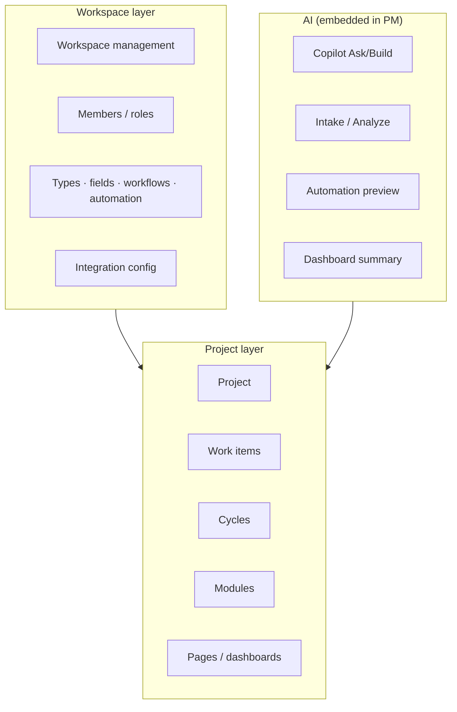
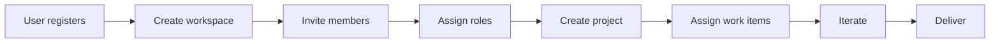
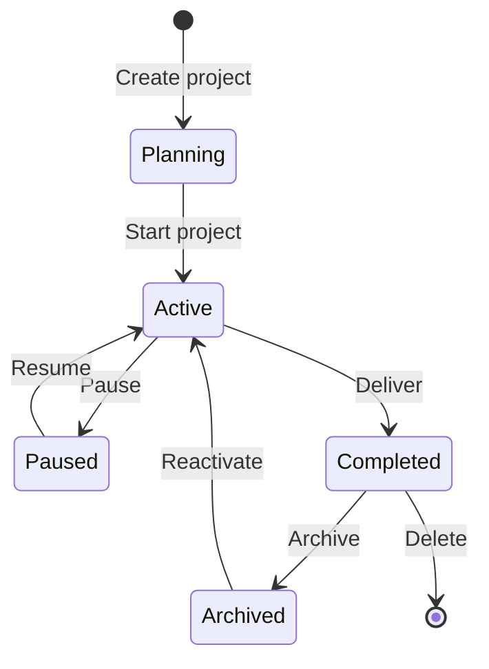
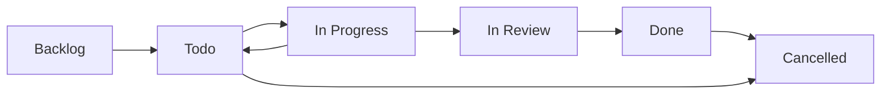
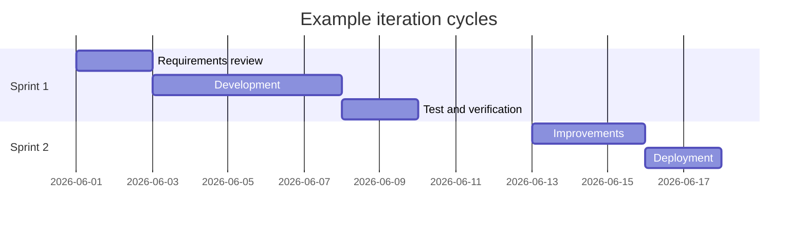
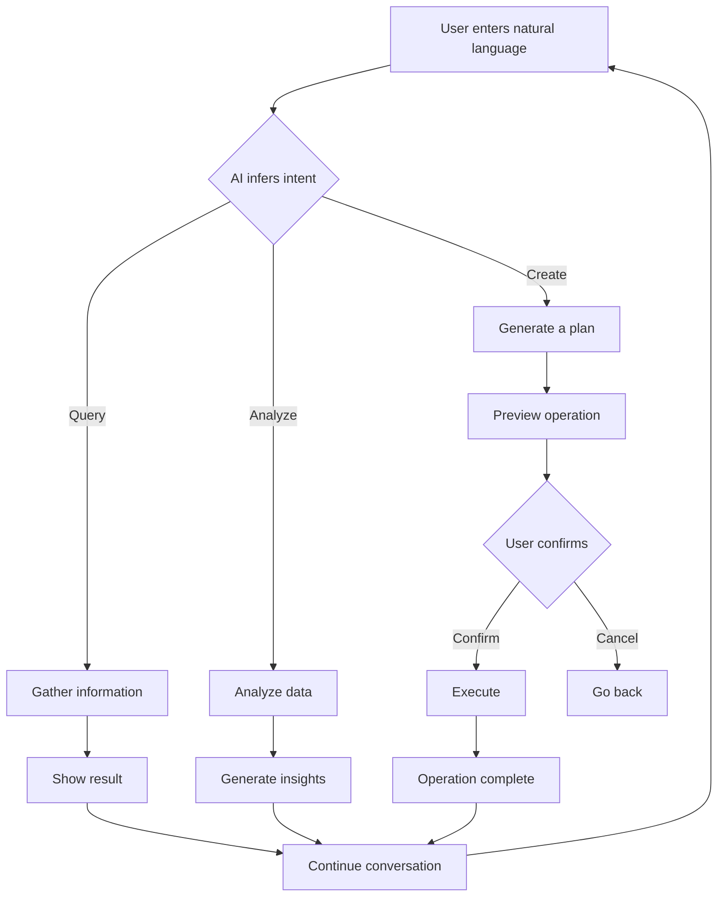
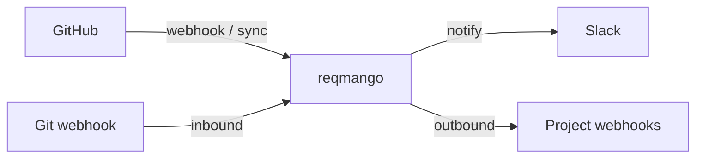
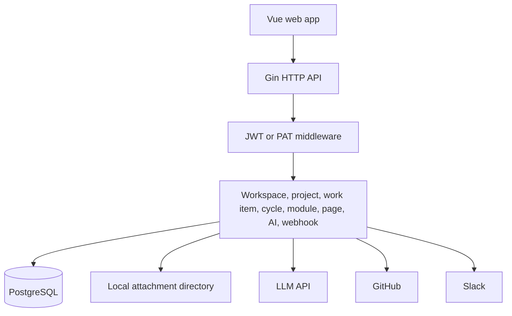
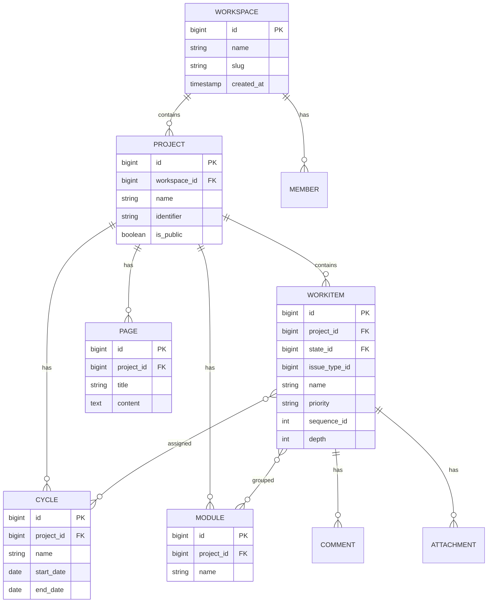

# reqmango Product Requirements Document

> **Last updated**: 2026-10-30
> **Status**: Current (source of truth for the knowledge base)
> **Product direction**: native project management plus a native AI project-management path (Intake / Analyze / automation / dashboard summaries).
> **Not the direction**: productizing Harness / Loop / a standalone Agent console (archived — see [superseded/agent-platform](https://github.com/vinthuy/reqmango/blob/master/docs/superseded/agent-platform/README.md)).
>
> Canonical Chinese original: [PRD.md](PRD.md).

---

## 1. Product Overview

reqmango is a modern project management platform: manage projects, work items, cycles, and documents inside a workspace; adapt the platform to a team's process with **customizable types / fields / workflows / automation**; and keep AI embedded in the PM path to help with triage, analysis, and rule drafts — not as a separate agent operations console.

### 1.0 Product direction (2026-09)

| Do | Don't |
|----|-------|
| Issue / Cycle / Module / Pages / Dashboard | Start new productization of Harness · Loop · multi-agent pipelines |
| **Custom issue types, custom fields, custom workflows, automation rules** (acceptance gate) | Expose the `/agents/*` console by default (requires `rm_advanced_agents=1`) |
| Intake triage, issue/project Analyze, NL→automation preview, `ai_summary` widget | Schedule a standalone Agent platform ("Agent as Teammates / full SDLC") |

Authoritative design: [AI PM redesign](https://github.com/vinthuy/reqmango/blob/master/docs/superpowers/specs/2026-09-25-ai-project-management-redesign.md) · Acceptance: [product-core-qa](https://github.com/vinthuy/reqmango/blob/master/docs/dev/acceptance/2026-09-25-product-core-qa.md)

### 1.1 Core values

- **A unified work hub**: projects, work items, documents, and collaboration in one platform
- **A configurable process core**: types, fields, state workflows, and automation rules are first-class capabilities
- **AI embedded in the workflow**: triage, analysis, rule drafts, dashboard summaries — with a preview before anything is written
- **Seamless integration**: GitHub / Slack and friends (as actually shipped)

### 1.2 Target users

Software, product, and cross-functional teams that deliver collaboratively — admins configure the process, members move work items forward.

---

## 2. Functional architecture

### 2.1 Product function matrix



### 2.2 Core functional modules

| Module | Priority | Description |
|--------|----------|-------------|
| Workspace / project / work items | P0 | Main path |
| **Custom types / fields / workflows / automation** | **P0 (gate)** | Required for commercialization; see acceptance §H |
| Cycles and modules | P0 | Iterations and feature grouping |
| Pages / dashboards / metrics | P1 | Documents and visualisation |
| AI (Intake / Analyze / preview / summary) | P1 | Embedded in PM, not a standalone platform |
| Third-party integrations | P2 | Git / Slack, etc. |

---

## 3. Workspace management

### 3.1 Overview

A workspace is the top-level container in reqmango, similar to an organization or company. It holds everything the team needs to collaborate: projects, members, settings, and configuration.

### 3.2 Core features

| Feature | Description | User action path |
|---------|-------------|------------------|
| Create workspace | First registration, or an additional workspace | Click workspace name → Create workspace |
| Workspace settings | Configure members, integrations, import/export | Workspace name → Settings |
| Member management | Invite, remove, assign roles | Settings → Members |
| Role permissions | Admin / Member / Guest, three levels | Settings → Role management |
| Workspace switch | Quick switch between workspaces | Workspace name → Select |
| Delete workspace | Permanent deletion (Admin required) | Settings → General → Delete workspace |

### 3.3 Member roles

| Role | Permission scope | Typical user |
|------|------------------|--------------|
| Admin | Full control | Team lead, project manager |
| Member | Create and edit resources | Team members, developers |
| Guest | Read-only or limited access | External collaborators, clients |

### 3.4 Workspace data flow



---

## 4. Project management

### 4.1 Overview

A project is the core unit for organizing team work. Each project can hold work items, cycles, modules, pages, and other resources aimed at a specific business goal.

### 4.2 Core features

| Feature | Description | Shortcut |
|---------|-------------|----------|
| Create project | New project with basic configuration | N → P |
| Visibility | Public or Private | Project settings |
| Project configuration | Identifier, timezone, feature toggles | Project settings |
| Enable features | Cycles, Modules, Views, etc. | Project settings → Features |
| Archive project | Keep the data, hide it from view | Project settings |
| Restore project | Bring back from archived state | Project list |
| Delete project | Permanent deletion (confirmation required) | Project settings |

### 4.3 Project configuration

| Item | Description | Example |
|------|-------------|---------|
| Project name | Describes the project's purpose | User authentication |
| Project identifier | Unique code prefixed to every work item | UA-123 |
| Visibility | Who can access the project | Public / Private |
| Timezone | Used for time calculations | Asia/Shanghai |
| Feature toggles | Enable/disable Cycles, Modules, etc. | Enable Cycles |

### 4.4 Project lifecycle



---

## 5. Work item management

### 5.1 Overview

A work item is the basic carrier of work in a project. reqmango supports multiple work item types — Issue, Task, Bug, and more — each with customizable states, priorities, and fields.

### 5.2 Core features

| Feature | Description |
|---------|-------------|
| Create work item | Quickly create a task, bug, or feature |
| Assign owner | Set who handles the work item |
| Set state | From Todo through In Progress to Done |
| Set priority | Urgent, High, Medium, Low |
| Add labels | Custom classification labels |
| Description | Rich text, Markdown supported |
| Associate cycle | Put the work item into an iteration |
| Associate module | Group by functional module |
| Associate page | Attach related documentation |
| Comments | Discuss under the work item |
| Attachments | Add file attachments |
| Activity log | View change history |

### 5.3 Work item state flow



### 5.4 Work item type definitions

| Type | Purpose | Typical scenario |
|------|---------|------------------|
| Issue | General problem or task | Requirements, feature points |
| Task | Concrete execution task | Implementation, documentation |
| Bug | Defect report | Fixing errors |
| Story | User story | Agile development |
| Epic | Large feature set | Long-term planning |

### 5.5 Custom fields (custom properties)

Custom fields let users attach type-specific attributes to work items, giving teams more flexible data management.

#### 5.5.1 Field types

| Field type | Attributes | Description |
|------------|------------|-------------|
| **Text** | Single line, paragraph, read-only | Short text or long descriptions |
| **Number** | Default value | Counts, estimates, and other numeric values |
| **Dropdown** | Single select, multi select | Predefined option lists |
| **Boolean** | True/False | Switch-like attributes |
| **Date** | Date format | Date selection |
| **Member selector** | Single select, multi select | Link project members |
| **Release selector** | Multi select | Link releases |
| **URL** | Link | External resources |

#### 5.5.2 Core features

| Feature | Description |
|---------|-------------|
| Create custom field | Add a custom attribute to a work item type |
| Field attributes | Required, optional, read-only |
| Default value | Set defaults for number, dropdown, etc. |
| Manage dropdown options | Add, edit, delete options |
| Update field values | Edit custom field values on a work item |
| Activity tracking | Record changes to custom field values |

#### 5.5.3 Examples

**Bug type custom fields:**
- Affected version (dropdown)
- Fix version (dropdown)
- Environment (dropdown: dev, staging, production)
- Reproduction steps (paragraph text)
- Approval status (dropdown)

**Product release type fields:**
- Release date (date)
- Target markets (dropdown, multi select)
- Budget (number)
- Approval status (dropdown)
- Owner (member selector)

#### 5.5.4 Validation rules

- Required fields must be filled in when creating a work item
- Read-only fields cannot be edited
- Number fields can define a valid range
- Dropdown fields can allow or disallow multiple selection

---

## 6. Cycle management

### 6.1 Overview

Cycles organize and manage iterative work. They help a team finish a set of related work items inside a fixed timebox — reqmango's version of a Scrum sprint.

### 6.2 Core features

| Feature | Description |
|---------|-------------|
| Create cycle | Set name and date range |
| Assign work items | Bring work items into the cycle |
| Track progress | See the cycle completion rate |
| Start/end cycle | Control whether the cycle is active |
| Cycle reports | Burndown chart, statistics views |
| Cycle templates | Reuse a cycle configuration |

### 6.3 Cycle view



---

## 7. Module management

### 7.1 Overview

Modules group work items by feature or business domain. Unlike cycles, which slice by time, modules organize along functional lines.

### 7.2 Core features

| Feature | Description |
|---------|-------------|
| Create module | Define a functional module name |
| Add work items | Bring related work items into the module |
| Module progress | See overall completion |
| Module members | Assign owners |
| Module timeline | Set target and due dates |

---

## 8. Pages and documents

### 8.1 Overview

Pages is reqmango's documentation and knowledge management tool. Teams use it for product specs, meeting notes, team guidelines, and more, with collaborative editing.

### 8.2 Core features

| Feature | Description |
|---------|-------------|
| Create page | New blank page |
| Rich text editing | Formatting, lists, tables |
| Markdown support | Full Markdown syntax |
| AI assistance | Generate content, summarise, translate |
| Mention work items | @-mention work items in a document |
| Block operations | Copy link, copy, delete blocks |
| Convert to work item | Turn text into a work item |
| Full-width mode | Expand the editing area |
| Page lock | Prevent accidental edits |
| Version history | View and restore previous versions |
| Export | Export to Markdown, PDF |
| Move page | Change the page hierarchy |

### 8.3 Page editor capabilities

```mermaid
flowchart TB
    A[Page editor] --> B[Text formatting]
    A --> C[AI assistant]
    A --> D[Mentions]
    A --> E[Block operations]

    B --> B1[Headings/lists/tables]
    C --> C1[Generate content]
    C --> C2[Summarise]
    C --> C3[Translate]
    D --> D1[@work item]
    D --> D2[Link navigation]
    E --> E1[Copy/delete]
    E --> E2[Convert to work item]
```

---

## 9. AI assistant

### 9.1 Overview

reqmango AI is an assistant built into the platform: users talk to project data in natural language to get information, create content, and perform actions quickly.

### 9.2 Core features

| Feature | Description |
|---------|-------------|
| AI chat | Ask project questions in conversation (Ask is read-only / Build can write) |
| Natural language search | Search work items in everyday language |
| Smart create | Describe a need; AI generates work items |
| Data analysis | Issue- or project-level Analyze: summary, insights, bottlenecks |
| Project summary → Page | One-click AI summary of a project, optionally saved as a Page |
| Dashboard AI summary | `ai_summary` widget on dashboards; loads on open, refreshable |
| Context awareness | AI understands the current project, issue, and page |
| Out-of-box PM agent | ensure-pm; issue assignment / @Agent in comments / activity audit |

### 9.3 AI conversation modes

| Mode | Purpose |
|------|---------|
| Ask | Query information and get answers |
| Build | Create work items and execute operations |

### 9.4 AI operation flow



---

## 14. Automation workflows

### 14.1 Overview

reqmango supports flexible automation rules so teams can cut repetitive work: when specific conditions hold, predefined actions run automatically.

### 14.2 Automation components

| Component | Description |
|-----------|-------------|
| Trigger | Defines when the automation fires |
| Condition | Filters the target objects |
| Action | The operations to perform |

### 14.3 Common automation scenarios

| Scenario | Trigger | Action |
|----------|---------|--------|
| Auto-assign | Work item created | Assign to owner |
| Status sync | Work item completed | Update related work items |
| Reminders | Due date approaching | Send a reminder |
| Label management | Specific condition met | Add a label automatically |
| AI triage/risk/spec templates | `issue.created` etc. | `dispatch_agent` etc. (one-click templates in settings) |
| Natural-language rules | User describes intent | `automation-preview` drafts a rule → confirm in RuleBuilder and save |

---

## 15. Time tracking

### 15.1 Overview

reqmango ships native time tracking so teams can record and manage working hours.

### 15.2 Core features

| Feature | Description |
|---------|-------------|
| **Time entries** | Log time manually or automatically |
| **Time estimates** | Set an estimate on a work item |
| **Time reports** | View statistics and trends |
| **Time approval** | Approval flow for time entries |

---

## 16. Custom dashboards

### 16.1 Overview

Custom dashboards let teams build personalised data views and monitor project progress and team performance in real time.

### 16.2 Core features

| Feature | Description |
|---------|-------------|
| **Dashboard creation** | Custom dashboard layouts |
| **Chart widgets** | Multiple chart types (bar, pie, line) |
| **Data filtering** | Filter by project, cycle, member |
| **Live updates** | Data refreshes in sync |
| **Workspace analytics** | Workspace-wide data analysis |

---

## 17. Command K navigation

### 17.1 Overview

Command K is reqmango's keyboard-first quick action surface: navigate and act without leaving the keyboard.

### 17.2 Core features

| Feature | Description |
|---------|-------------|
| **Quick search** | Search work items, projects, pages |
| **Quick navigation** | Jump to any page |
| **Quick actions** | Create, update, delete work items |
| **Shortcuts** | Full keyboard operation |

---

## 18. Third-party integrations

### 18.1 Overview

reqmango offers native integrations that connect to the tools teams already use, so nobody has to switch platforms mid-task.

### 18.2 Supported integrations

| Integration | Capability |
|-------------|------------|
| GitHub | Workspace connection, issue sync, inbound webhook |
| Git | Workspace Git integration, plus `POST /webhook/git/:projectId` |
| Slack | Workspace connection that sends notifications outward |
| Webhooks | Outbound webhooks configured on a project |
| Bulk import | CSV/JSON work-item import. Columns can be mapped from Jira, Linear, or Plane exports |

There is no GitHub Enterprise connector, GitLab merge-request tracking, Sentry, Draw.io, or a dedicated Jira connector.

### 18.3 Integration architecture



---

## 19. Audit and compliance

### 19.1 Overview

Work-item changes are stored on `issue_activities`. There is no separate compliance checklist, compliance archive, or audit export.

### 19.2 What is recorded

| Record | Description |
|--------|-------------|
| **Work-item activity** | `issue_activities` stores changes on a work item |
| **Access** | People who can see the work item can see that activity |

---

## 20. Enterprise authentication

### 20.1 Overview

Sign-in is email and password. The server issues a JWT. Long-lived calls use a personal access token with the prefix `reqmango_pat_`; only the SHA-256 hash is stored.

There is no SSO, SAML, OIDC, or LDAP.

### 20.2 Methods

| Method | Notes |
|--------|-------|
| **Password** | Stored as a bcrypt hash |
| **JWT** | `Authorization: Bearer`. Login returns `access_token`, `token_type`, and `expires_at` |
| **Personal access token** | Same Bearer header, recognized before JWT |

---

## 21. User interface design

### 21.1 Design principles

- **Clear and direct**: important information at a glance
- **Efficient**: fewer clicks, keyboard shortcuts
- **Consistent**: one visual language and interaction model
- **Responsive**: desktop, tablet, mobile

### 21.2 Colour scheme

| Purpose | Value | Notes |
|---------|-------|-------|
| Primary | #6366F1 | Indigo, for primary buttons and emphasis |
| Secondary | #8B5CF6 | Violet, for AI-related surfaces |
| Success | #10B981 | Green, completed states |
| Warning | #F59E0B | Orange, pending items |
| Error | #EF4444 | Red, errors or urgency |
| Background | #FFFFFF / #F9FAFB | White / light grey |
| Text | #111827 / #6B7280 | Dark grey / mid grey |

### 21.3 Layout

| Region | Content |
|--------|---------|
| Sidebar | Workspace, project, cycle, module, page navigation |
| Top bar | Search, AI assistant, notifications, user menu |
| Main area | Work item list, board, detail pages |
| Right panel | Work item detail, comments (collapsible) |

---

## 22. Technical architecture

### 22.1 System architecture

The runtime is one Go process and a Vue frontend. There is no separate gateway, auth service, Redis, or object store. Attachments are written to a local directory.



### 22.2 Technology choices

The project uses **Vue 3 + Go + Gin + GORM**.

| Layer | Technology | Notes |
|-------|------------|-------|
| Frontend framework | Vue 3 + Composition API | Component-based, reactive |
| Build tool | Vite | Fast development loop |
| Styling | TailwindCSS | Utility-first CSS |
| State management | Pinia | The Vue 3 default |
| Frontend types | TypeScript | Type safety |
| Backend framework | Go + Gin 1.x | High-performance HTTP |
| Validation | Gin ShouldBindJSON | Request binding and validation |
| ORM | GORM 2.x | Go ORM |
| Database | PostgreSQL 16+ | Relational store |
| Authentication | JWT (golang-jwt/v5) or a personal access token | The same Bearer header |
| File storage | Local filesystem | Attachment uploads |
| AI integration | DeepSeek / Anthropic / OpenAI | LLM support (SSE streaming) |
| Query language | RQL (custom) | Advanced work item search |

### 22.3 Database model (core entities)

Primary keys are autoincrement `uint64`, not UUIDs. The diagram below is only the main path. All 131 tables are in [data-model.md](architecture/data-model.md).



---

## 23. Non-functional requirements

### 23.1 Performance

| Metric | Target |
|--------|--------|
| Page load time | < 2 seconds |
| API response time | < 500 ms |
| AI response time | < 5 seconds |
| Concurrent users | 1000+ |

### 23.2 Security

- Deployments that face the network should use HTTPS. The application does not terminate TLS
- Passwords are stored with bcrypt. Personal access tokens store only SHA-256. The database file is not encrypted by the application
- Role-based access control (RBAC), plus the tenancy checks in `scope.go`
- Work-item changes are stored on `issue_activities`
- No SSO, SAML, OIDC, or LDAP

### 23.3 Availability

- 99.9% service availability
- Multi-timezone, multi-language support
- Clear error messages and help documentation
- Backup and restore

---

## 24. Implementation status (summary)

The main path, AI PM (P1–2 + B1–C2), and native PM acceptance (including the core-customization gate) are **complete**.
The detailed phase tables and schema lists are historical planning and no longer drive scheduling; code and acceptance documents are authoritative.

| Milestone | Status | Documentation |
|-----------|--------|---------------|
| Native PM main path | ✅ PASS | [product-core-qa](https://github.com/vinthuy/reqmango/blob/master/docs/dev/acceptance/2026-09-25-product-core-qa.md) |
| AI PM native AI project-management path | ✅ PASS | [redesign](https://github.com/vinthuy/reqmango/blob/master/docs/superpowers/specs/2026-09-25-ai-project-management-redesign.md) |
| Agent platform productization | ❌ Retired | [superseded/agent-platform](https://github.com/vinthuy/reqmango/blob/master/docs/superseded/agent-platform/README.md) |
| Next stage | Existing-product quality | No new large AI features |

---

**Document version**: v5.0 (product direction refresh + core-customization gate)
**Created**: 2026-06-13 · **Refreshed**: 2026-10-30
**Project**: reqmango

---

## 🌐 Language

- **English** (this document)
- [中文文档](PRD.md)
